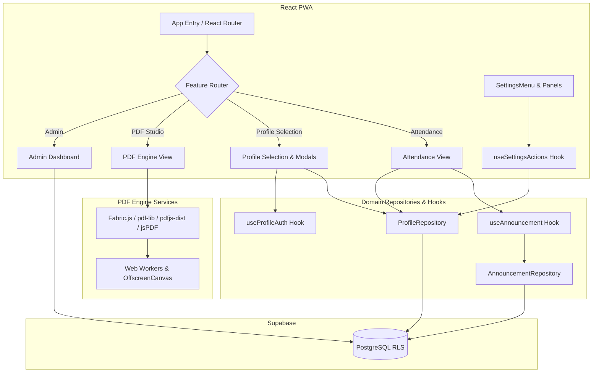

# Flowwsuite

> **A Comprehensive, High-Performance Suite for Attendance Tracking, Secure Administration, and Client-Side PDF Generation**

[](LICENSE)
[](https://react.dev)
[](https://vitejs.dev)
[](https://www.typescriptlang.org)
[](SECURITY.md)

Flowwsuite is a high-performance, privacy-focused Progressive Web Application (PWA). It unifies attendance tracking, administrative management, and a robust PDF conversion engine into a single, blazing-fast experience. 

Through aggressive chunk splitting, asynchronous script injection, and granular lazy loading, Flowwsuite guarantees sub-50ms DOMContentLoaded metrics from cache, delivering a near-native mobile experience. The codebase is heavily tested with 100% unit test coverage for core business logic and is fully type-safe with zero TypeScript or ESLint errors.

---

## 🌟 Key Features

### 🎓 Attendance Tracker
- **Smart Tracking**: Monitor attendance goals (75% target) via interactive Progress Rings.
- **Real-Time Syncing**: Cloud synchronization powered by Supabase.
- **Audit Trails**: Maintain a verifiable log of all attendance modifications.
- **Export**: Generate attendance reports natively on the device.

### 🛡️ Admin Security Portal
- **Centralized Control**: Manage users, roles, and profiles.
- **Broadcast System**: Create and broadcast rich-text announcements directly to students via in-app modals.
- **Real-Time Database**: Built securely over Supabase Row Level Security (RLS).

### 📄 PDF Engine (Studio)
- **100% Client-Side**: Powered by Web Workers, WebAssembly, and OffscreenCanvas. No files are ever uploaded to a server, ensuring maximum data privacy.
- **Memory Efficient**: Zero-copy transfers with `ArrayBuffer`.
- **Format Support**: Seamlessly handles JPG, PNG, and Apple HEIC formats natively in the browser.

### ⚡ Performance & Mobile First
- **Sub-50ms Hydration**: Customized Vite configuration unblocks the main thread for instantaneous loading.
- **Bento-grid & Glassmorphism UI**: Beautiful, micro-interaction rich, and responsive mobile-first aesthetic.

---

## 🏗️ Architecture



## 🛠️ Tech Stack

- **Core**: [React 19](https://react.dev) + [TypeScript](https://www.typescriptlang.org) + [Vite 7](https://vitejs.dev)
- **Styling**: [Tailwind CSS](https://tailwindcss.com) + [Framer Motion](https://www.framer.com/motion/)
- **State Management**: [Zustand](https://zustand-demo.pmnd.rs/)
- **Backend & Auth**: [Supabase](https://supabase.com)
- **PDF Generation**: [jsPDF](https://rawgit.com/MrRio/jsPDF/master/docs/index.html) + [Fabric.js](http://fabricjs.com/)

---

## 🚀 Getting Started

### Prerequisites
- Node.js (v18 or higher)
- npm or yarn

### Installation
1.  **Clone the Repository**
    ```bash
    git clone https://github.com/Raj-Likhit/convertfloww.git
    cd convertfloww
    ```

2.  **Install Dependencies**
    ```bash
    npm install
    ```

3.  **Set Up Environment Variables**
    Create a `.env` file based on `.env.example` to configure the cloud backend:
    ```env
    VITE_SUPABASE_URL=your_url
    VITE_SUPABASE_ANON_KEY=your_key
    ```

4.  **Start Development**
    ```bash
    npm run dev
    ```

---

## 🛡️ Security

Security is the core of Flowwsuite. For more details on how we handle your data, please see our [SECURITY.md](SECURITY.md) file.

## 🤝 Contributing

We welcome contributions! Please review our [CONTRIBUTING.md](CONTRIBUTING.md) to understand our feature-based architecture and performance requirements.

## 📄 License

This project is licensed under the MIT License - see the [LICENSE](LICENSE) file for details.
