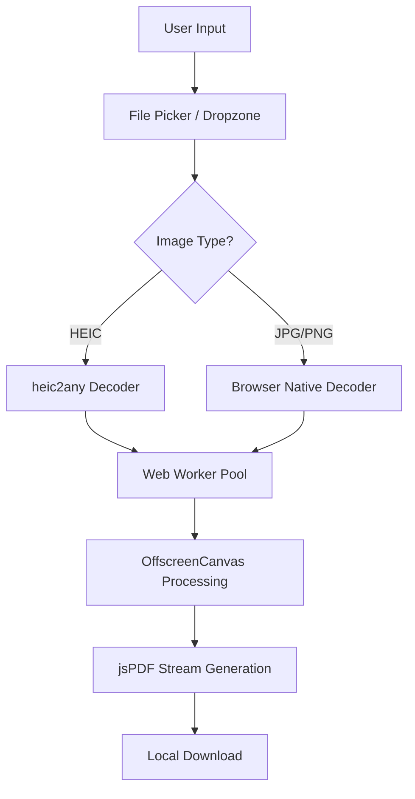

# Flowwsuite

> **Professional, Client-Side Image to PDF Converter**

[](LICENSE)
[](https://react.dev)
[](https://vitejs.dev)
[](https://www.typescriptlang.org)
[](SECURITY.md)

Flowwsuite is a high-performance, privacy-focused web application that converts images to PDF entirely within your browser. By utilizing WebAssembly and Web Workers, your data never leaves your device, ensuring maximum security and speed.

---

## 🌟 Key Features

- **100% Client-Side**: Powered by WebAssembly. No files are ever uploaded to a server.
- **Enterprise-Grade UI**: Micro-interactions, glassmorphism aesthetic, and Bento-grid layout.
- **High Performance**:
  - **Multi-Threaded**: Parallel image processing using Web Worker pools.
  - **GPU Accelerated**: OffscreenCanvas rendering for blazing-fast conversion.
  - **Memory Efficient**: Zero-copy transfers with `ArrayBuffer` and rigorous memory cleanup.
- **Mobile First**:
  - **Thumb-Zone UX**: Critical controls optimized for mobile usage.
  - **Responsive Design**: Seamlessly transitions between mobile and desktop dual-grid layouts.
- **Format Support**: Seamlessly handles JPG, PNG, and HEIC (Apple Photos).

---

## 🏗️ Architecture



## 🛠️ Tech Stack

- **Core**: [React 19](https://react.dev) + [TypeScript](https://www.typescriptlang.org) + [Vite 7](https://vitejs.dev)
- **Styling**: [Tailwind CSS](https://tailwindcss.com) + [Framer Motion](https://www.framer.com/motion/)
- **State Management**: [Zustand](https://zustand-demo.pmnd.rs/)
- **PDF Generation**: [jsPDF](https://rawgit.com/MrRio/jsPDF/master/docs/index.html)
- **Backend Services**: [Supabase](https://supabase.com) (for secure administration)

---

## 🚀 Getting Started

### Prerequisites
- Node.js (v18 or higher)
- npm or yarn

### Installation
1.  **Clone the Repository**
    ```bash
    git clone https://github.com/Raj-Likhit/convertfloww.git
    cd convertfloww
    ```

2.  **Install Dependencies**
    ```bash
    npm install
    ```

3.  **Set Up Environment Variables**
    Create a `.env` file based on `.env.example`:
    ```env
    VITE_SUPABASE_URL=your_url
    VITE_SUPABASE_ANON_KEY=your_key
    ```

4.  **Start Development**
    ```bash
    npm run dev
    ```

---

## 🛡️ Security

Security is the core of Flowwsuite. For more details on how we handle your data, please see our [SECURITY.md](SECURITY.md) file.

## 🤝 Contributing

We welcome contributions! Please review our [CONTRIBUTING.md](CONTRIBUTING.md) to get started.

## 📄 License

This project is licensed under the MIT License - see the [LICENSE](LICENSE) file for details.
